# ESPHome HotCirc - Smart Hot Water Circulation Controller

A self-learning hot water circulation pump controller built on ESPHome. The system detects water usage patterns, builds a weekly schedule, and pre-heats the circulation loop so hot water is available at the tap without waiting.

Three hardware variants are supported, all sharing the same core component.

## Table of Contents

- [Overview](#overview)
- [Hardware Variants](#hardware-variants)
  - [Red (ESP32-C6)](#red-esp32-c6)
  - [M5StickC Plus2 (ESP32)](#m5stickc-plus2-esp32)
  - [UEDX4646 (ESP32-S3)](#uedx4646-esp32-s3)
- [How It Works](#how-it-works)
  - [Water Draw Detection](#water-draw-detection)
  - [Learning Matrix](#learning-matrix)
  - [Pump Control](#pump-control)
  - [Vacation Mode](#vacation-mode)
  - [Disinfection Cycle](#disinfection-cycle)
  - [Thermal Stagnation Flush](#thermal-stagnation-flush)
  - [Anti-Stagnation](#anti-stagnation)
  - [Operating Modes at a Glance](#operating-modes-at-a-glance)
- [Smart Plug Control](#smart-plug-control)
- [Learning Matrix Heatmap](#learning-matrix-heatmap)
- [Home Assistant Integration](#home-assistant-integration)
- [Configuration](#configuration)
  - [Component Parameters](#component-parameters)
  - [Web UI Controls](#web-ui-controls)
  - [Button Actions](#button-actions)
  - [Logging](#logging)
- [Installation](#installation)
- [Upgrading](#upgrading)
- [Project Structure](#project-structure)
- [License](#license)

---

## Overview

The HotCirc controller monitors outlet and return water temperatures using DS18B20 sensors. When it detects a tap being opened (rising outlet temperature), it learns the time of day and day of week into a 7x48 matrix (48 half-hour slots per day). Over time the system builds a usage profile and starts the circulation pump just before anticipated demand.

Key capabilities:

- **Adaptive learning** - automatically adjusts to changing household routines
- **ECO level control** - a single slider (0-255) sets how aggressively the pump pre-heats
- **Disinfection support** - detects boiler disinfection cycles and runs the pump to flush the entire loop
- **Thermal stagnation flush** - short flush when the return pipe heats up by conduction (summer operation)
- **Anti-stagnation** - weekly short pump run prevents impeller seizure while the pump is disabled or in vacation mode
- **Vacation mode** - automatically suspends automatic runs after 24 hours without water usage
- **Energy tracking** - reports energy transferred and duration per pump cycle
- **Multiple interfaces** - hardware button, display/touchscreen/rotary encoder, web UI and Home Assistant

---

## Hardware Variants

| | Red (ESP32-C6) | M5StickC Plus2 (ESP32) | UEDX4646 (ESP32-S3) |
|---|---|---|---|
| **MCU** | ESP32-C6, 4 MB flash | ESP32 | ESP32-S3, 16 MB flash, octal PSRAM |
| **Pump control** | Direct GPIO relay (GPIO14) | Smart plug via HTTP | Smart plug via HTTP |
| **Display** | None | 1.14" TFT 135x240 (ST7789V) | 1.5" round AMOLED 466x466 (CO5300, QSPI), LVGL GUI |
| **Input** | Hardware button | Hardware button | Hardware button + touchscreen (CST816) + rotary encoder |
| **Feedback** | 3 LEDs (green/yellow/WiFi) | TFT display | Round display with ECO arc, state colors and heatmap page |
| **1-Wire** | GPIO21 (shared bus, addressed) | GPIO26 (shared bus, addressed) | GPIO39 outlet, GPIO40 return (one sensor per bus) |
| **Button pin** | GPIO23 | GPIO37 | GPIO0 |

### Red (ESP32-C6)

This variant requires a special PCB that replaces the original one of the Vortex BWO155 pump. It
controls the pump directly through a GPIO with no display. Three LEDs provide status feedback.
It fits into the original housing of the BWO155 pump:

- **Green LED** (GPIO2) - pump running
- **Yellow LED** (GPIO3) - lights for 5 s on a confirmed water draw, steady on while learning is disabled, blinks three times after a matrix reset
- **WiFi LED** (GPIO22) - blinks while disconnected, steady when connected

Unique to this variant: an ADC input (GPIO1) reads the pump's internal NTC thermistor through a voltage divider (factor 0.45). The voltage is converted to a temperature with a Steinhart-Hart fit. This is a research feature for correlating the pump's built-in sensor with the external DS18B20, potentially replacing it in the future. The values are internal (not exposed to the web UI or Home Assistant) and are logged every 10 s under the `correlation` log tag.

An interactive BOM for the PCB is included as `esphome-hotcirc_red_ibom.html`, the schematic as `pictures/hotcirc_red/Schematics_hotcirc_red.pdf`.

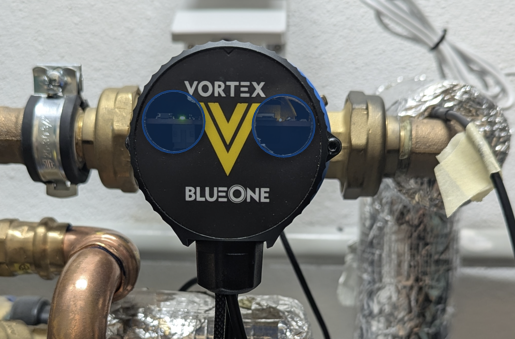

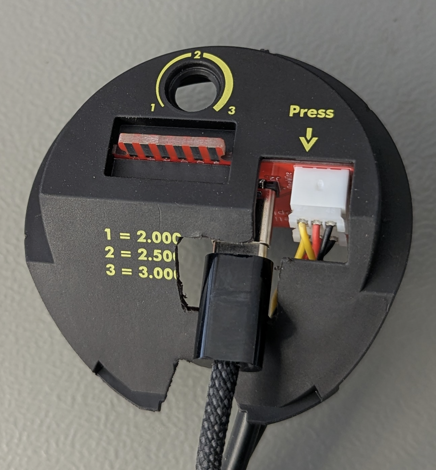

| PCB Top | PCB Bottom |
|---|---|
| 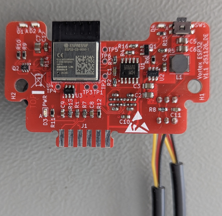 | 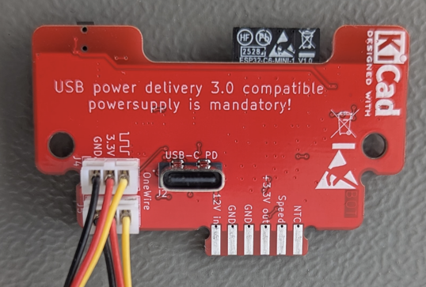 |

### M5StickC Plus2 (ESP32)

Uses the M5StickC Plus2 form factor with a small 135x240 TFT display. The pump is controlled through a smart plug over HTTP rather than a direct relay, making it suitable for setups where the pump is physically distant from the controller.

The display shows:

- WiFi signal strength icon with 1-3 arcs (green = connected, red with strikethrough and "AP" = access point mode)
- Pump status (RUNNING / STANDBY / DISABLED) and a pump symbol
- Outlet temperature (orange) and return temperature (blue)
- Smart plug IP address (green = reachable, red with strikethrough = unreachable)
- Current trigger reason when the pump is running

The display backlight (GPIO27, PWM) is exposed as the light entity "Display Backlight".


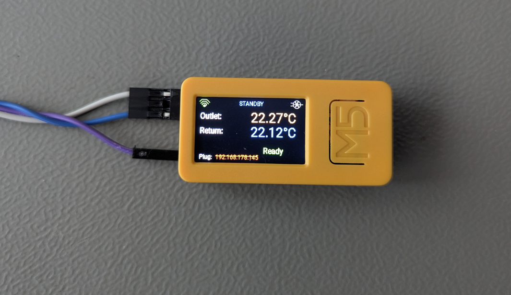

### UEDX4646 (ESP32-S3)

The most feature-rich variant, built around a 466x466 round AMOLED display with capacitive touch and a rotary encoder for ECO level adjustment. The GUI is built with LVGL in a Nest-thermostat-inspired style and lives in reusable packages (see [Project Structure](#project-structure)).

The LCD module requires GPIO17 to be driven HIGH at boot to enable its power supply (`lcd_power` output, switched on in `on_boot`).

**Pin assignment:**

| Function | Pins |
|---|---|
| Display QSPI | CLK GPIO10, data GPIO13/11/14/9, CS GPIO12, reset GPIO8 |
| LCD power | GPIO17 |
| Touch (CST816, I²C) | SDA GPIO1, SCL GPIO3, INT GPIO4, RST GPIO2 |
| Rotary encoder | A GPIO5, B GPIO6 |
| Hardware button | GPIO0 |
| 1-Wire | GPIO39 (outlet), GPIO40 (return) |

#### Main page

- **Outer ring:** 300° arc (gap at the bottom) showing the ECO level (0-255), with a dot marking the current value
- **Top:** "HotCirc" title (orange "Hot", light grey "Circ") and an ENABLED/DISABLED badge
- **Left/right:** OUTLET and RETURN temperatures. The outlet value turns **yellow** while a potential water draw is being tracked
- **Center:** pump icon - white (standby), green and animated (running), magenta (disinfection), grey (disabled)
- **Below center:** pump status text (e.g. `Running: Water Draw`) and ECO level readout
- **Bottom:** if the smart plug is unreachable: WiFi status, RSSI and `Plug: --`. If it is reachable: only `Plug: <IP>`, colored red → yellow → green by WiFi signal strength (-80 … -50 dBm)

The ring, dot, status text and a radial background glow change color with the operating state:

| State | Color |
|---|---|
| Standby / idle | Blue |
| Running (any trigger except disinfection) | Orange |
| Disinfection | Magenta |
| Disabled | Grey, black background |

#### Heatmap page

Tapping the upper part of the main page opens the learning matrix: 7 rows (Mo-Su) x 48 half-hour columns with a time axis (0/6/12/18/24 h) and the current ECO level. Cell colors:

| Value | Color |
|---|---|
| 0 | Dark grey |
| 1 - 49 | Blue |
| 50 - 119 | Green |
| 120 - 189 | Orange |
| 190 - 255 | Red |
| ≥ ECO level | Yellow (slot triggers a scheduled run) |

The canvas is checked every 30 s and only redrawn when the matrix or the ECO level has changed.

#### Touch, encoder and button

| Input | Action |
|---|---|
| Tap upper area (top 310 px) | Switch between main page and heatmap page |
| Tap lower area (bottom 156 px) | Test smart plug connection |
| Tap anywhere on the heatmap page | Back to main page |
| Rotary encoder | ECO level ±5 per detent |
| Hardware button | Start/stop the pump, toggle learning or reset the matrix, see [Button Actions](#button-actions) |

If the display is dimmed or dark, the first touch or encoder step only wakes it up; the touch action or encoder step itself is discarded. The hardware button wakes the display and performs its action with the same press.

#### Display dimming (AMOLED burn-in protection)

| Stage | After inactivity | Brightness |
|---|---|---|
| Active | - | "Display Brightness" slider (10-255, default 64) |
| Dim | 30 s | 25 % of active brightness (minimum 8), content keeps updating |
| Dark | 5 min | 0 (screensaver) |

The dark stage can be disabled with the switch "Display Dark Mode"; the display then stays at the dim stage. A pump start also wakes the display. Delays and factors are set as substitutions at the top of `packages/esphome-hotcirc_dimming.yaml`.

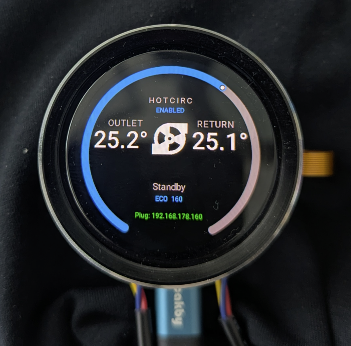

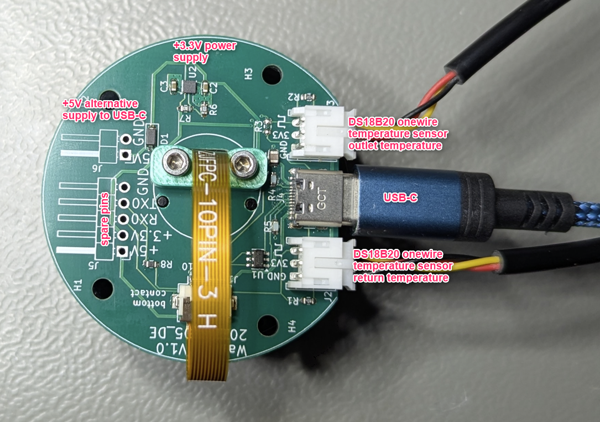

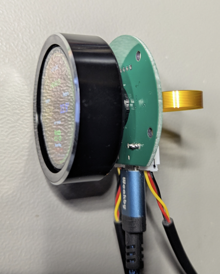

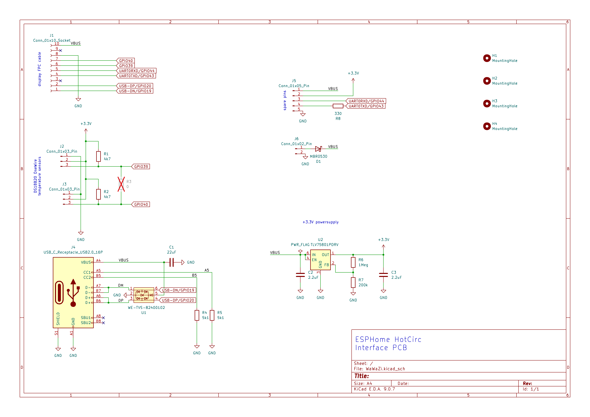

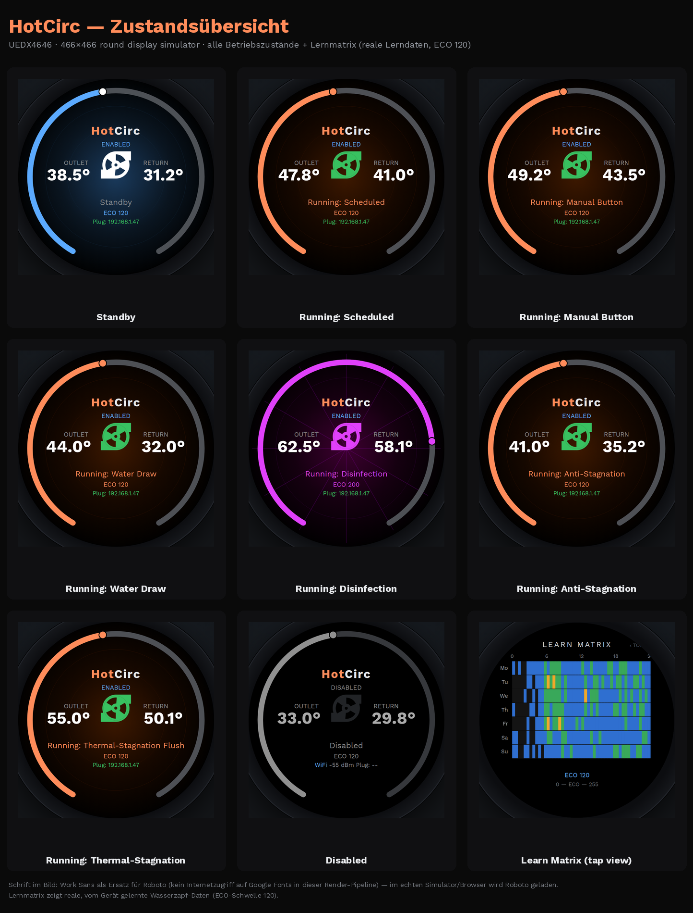

| Standby | Running | Learning | Disinfection |
|---|---|---|---|
| 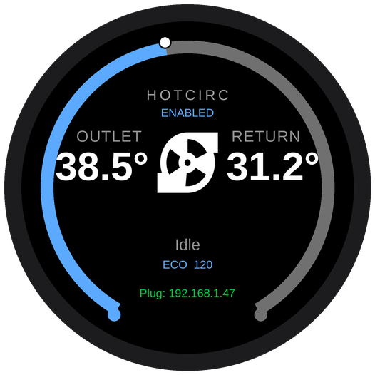 | 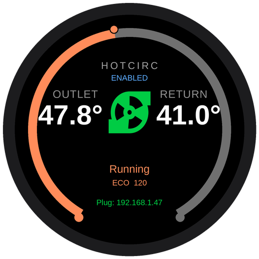 | 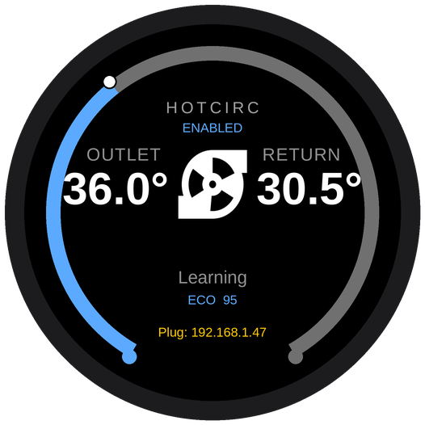 | 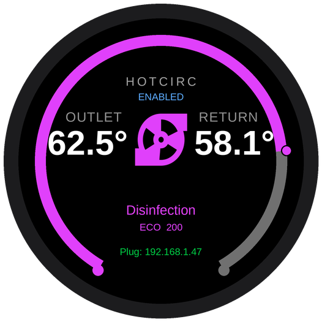 |
| **Disabled** | **Forced** | **Water draw** | **Learn matrix** |
| 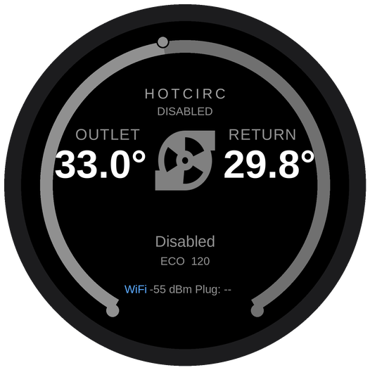 | 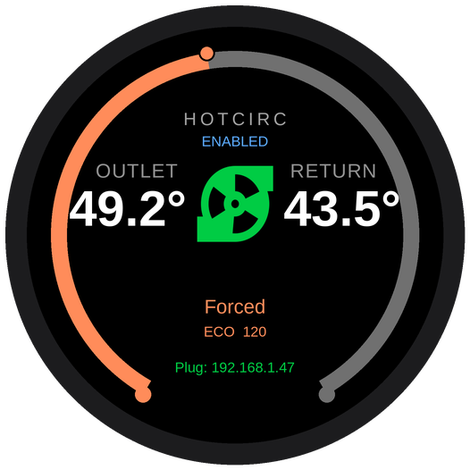 | 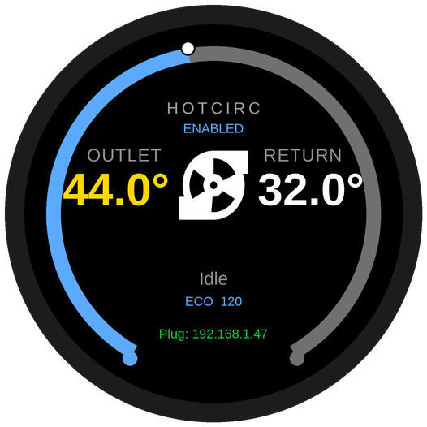 | 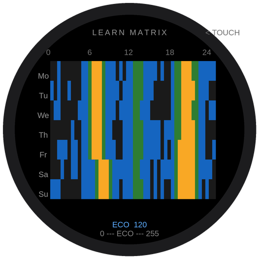 |

> **▶ [Open the interactive display simulator](https://stb3.github.io/esphome-hotcirc/hotcirc_simulator.html)** &mdash; the same display, live in your browser: switch between operating states, drag the ECO level to reshape the arc, watch the pump animate, and tap the screen to open the learning matrix. No hardware required.

> The simulator is a single self-contained HTML file ([`docs/hotcirc_simulator.html`](docs/hotcirc_simulator.html)) served via GitHub Pages.

---

## How It Works

### Water Draw Detection

The system exploits a specific physical property of the installation: the 40 cm pipe between the hot water tank outlet and the temperature sensor cools down when idle. When a tap opens, fresh hot water flows through this pipe and the sensor sees a **rising** temperature.

Detection is driven by the outlet sensor itself: the component registers a callback on the outlet sensor and evaluates every published reading (1 s interval). It is therefore not affected by `loop()` stalls caused by the display, heatmap redraws or WiFi scans.

For each new reading:

1. Calculate the rate of change: `rate = (current - previous) / elapsed_time`
2. If `rate >= 0.010 °C/s` and `delta > 0.03 °C`:
   - start tracking (if not already) and remember the start temperature
   - once the rise has lasted **15 s** and the total rise reaches the **outlet rise threshold**: **water draw confirmed**
3. Brief pauses or single negative steps do not reset tracking. Tracking is only abandoned if the total rise falls below -0.1 °C or no confirmation happens within 30 s.
4. Invalid readings (1-Wire CRC dropouts) are skipped without losing the tracking state.

Detection is paused while the pump is running and for 30 minutes after an anti-stagnation run.

On a confirmed draw the system:

- increments the current slot of the learning matrix (only if learning is enabled and the clock is synchronized),
- starts the pump, unless the pump already ran within the last 30 minutes.

Water draws are detected even before SNTP has synchronized; in that case the pump still runs but nothing is learned.

### Learning Matrix

The learning matrix is a 7-day by 48-slot grid (one slot per 30-minute period). Each cell holds a value from 0 to 255 representing how frequently water is drawn at that time.

**Learning:** Each confirmed water draw increments the current slot by 40 (capped at 255).

**Decay:** Once per day, at the first loop after the date changes, all values are multiplied by 0.98 and rounded down. Rounding down guarantees that every slot eventually returns to 0, so old patterns fade completely and the matrix adapts to changing routines.

**Scheduling:** Every 30 seconds the system checks whether the current slot's value is **greater than or equal to the ECO level**. If so, a scheduled pump cycle starts. Each slot triggers at most once.

**ECO level:** The single most important user-facing parameter. It directly corresponds to the matrix values visible in the heatmap:

- **0** - every slot triggers, including slots without any learned activity (pump runs every 30 minutes)
- **120** (default) - pump runs on slots with moderate-to-high activity
- **255** - pump runs only on slots with the highest learned confidence

**Default patterns:** When no valid saved data exists, the matrix is initialized with typical household patterns (morning, lunch, dinner and evening peaks; later mornings on weekends).

**Persistence:** The matrix is saved to flash after each daily decay, on manual save, and after a reset. Saved data carries a magic word (`HCR1`), a layout version and a checksum. If any of these does not match on boot, the matrix is re-initialized with the default pattern.

### Pump Control

| Trigger | Condition | Run time | Runs when disabled | Skipped if return ≥ min. return temp |
|---|---|---|---|---|
| Water draw | Confirmed draw, no pump run within the last 30 min | Temperature-controlled, 30-480 s | No | Yes |
| Scheduled | Learning matrix slot ≥ ECO level | Temperature-controlled, 30-480 s | No | Yes |
| Manual | Hardware button or web UI button | Temperature-controlled, 30-480 s | No | Yes |
| Disinfection | Outlet ≥ baseline + disinfection threshold | Full 480 s | No | No |
| Thermal stagnation | Return pipe heat soak (see below) | Fixed (default 10 s) | No | No |
| Anti-stagnation | Sunday 03:00, pump disabled or vacation mode | Fixed (default 15 s) | **Yes** | No |

**Stop condition (temperature-controlled runs):** The pump stops when it has run for at least 30 s **and** the return temperature has risen by the *return rise target* above its value at pump start (with 0.2 °C tolerance). A maximum run time of 480 s is always enforced as a safety limit.

**Baseline tracking:** After each temperature-controlled run, the outlet baseline is updated with a slow moving average (90 % old, 10 % new). At that moment fresh tank water is at the sensor, so the reading reflects the actual tank temperature. Disinfection, thermal stagnation and anti-stagnation runs do not update the baseline, because they are either abnormal or too short to bring tank water to the sensor.

**Energy calculation:**

```
Power (W)    = flow_rate (L/s) x delta_T (°C) x 4186 J/(L*°C)
Energy (kWh) = sum of Power x dt (h) / 1000
```

`delta_T` is outlet minus return; only positive differences are counted. The last cycle's energy and duration are exposed as sensors.

### Vacation Mode

Activates automatically after 24 hours without a detected water draw. In vacation mode:

- Decay, scheduled runs, disinfection detection and thermal stagnation flushes are **suspended**
- Water draw detection remains **active** - the first confirmed draw exits vacation mode
- Anti-stagnation runs continue to protect the pump

The 24-hour timer starts from the last draw, or from boot if no draw has been detected since.

### Disinfection Cycle

When the boiler runs a disinfection cycle (typically heating to 65-70 °C), the outlet temperature rises significantly above the baseline. If the rise reaches the disinfection threshold (default 10 °C), the pump runs for the full maximum time (480 s) to flush hot disinfection water through the entire circulation loop.

A 1-hour cooldown prevents re-triggering after a single disinfection event. Detection needs a valid baseline, i.e. at least one completed temperature-controlled pump run since boot.

### Thermal Stagnation Flush

In summer, when the boiler only heats domestic hot water, the return pipe can pick up heat by conduction. The outlet-return difference shrinks or even turns negative, so the normal stop condition and the *min. return temperature* check no longer work as intended.

If **all** of the following hold for 10 consecutive seconds:

- the return temperature is at least `thermal_stagnation_min_return` (default 40 °C), and
- `outlet - return < thermal_stagnation_delta` (default 2 °C),

the pump runs for `thermal_stagnation_runtime` seconds to flush the stagnant water out of the return pipe. A cooldown (default 30 min) applies between flushes. The flush respects the pump enable switch and is suspended in vacation mode.

### Anti-Stagnation

While the pump is disabled or the system is in vacation mode, a short pump run (default 15 s) prevents the impeller from seizing due to mineral deposits or biofilm.

It runs on a fixed weekly schedule: **Sunday between 03:00 and 03:05**, once per week. It bypasses the pump enable switch. For 30 minutes afterwards, water draw detection and scheduled runs are locked out.

> The former parameter `anti_stagnation_interval` is deprecated and no longer evaluated. It is still accepted by the schema so existing configurations validate.

### Operating Modes at a Glance

| Function | Normal | Pump disabled | Vacation mode |
|---|---|---|---|
| Water draw detection | ✓ | ✓ (learns, pump stays off) | ✓ (exits vacation) |
| Learning | ✓ | ✓ | on exit |
| Daily decay | ✓ | ✓ | - |
| Scheduled runs | ✓ | - | - |
| Disinfection detection | ✓ | - | - |
| Thermal stagnation flush | ✓ | - | - |
| Anti-stagnation | - | ✓ | ✓ |

---

## Smart Plug Control

The M5StickC Plus2 and UEDX4646 variants switch the pump through an ESPHome-based smart plug using the ESPHome web server REST API. The plug's relay switch must have the ID `relay`:

| Request | Purpose |
|---|---|
| `POST http://<plug-ip>/switch/relay/turn_on` | Pump on |
| `POST http://<plug-ip>/switch/relay/turn_off` | Pump off |
| `GET http://<plug-ip>/switch/relay` | Reachability and actual relay state (`{"value":true}` / `false`) |

The plug IP is set via the text input "Smart Plug IP Address" and stored in flash.

Every 60 seconds the controller queries the plug. The controller is master: if the plug's relay state differs from the expected state (e.g. the plug rebooted or a command was lost), the command is re-sent.

Robustness:

- HTTP requests are only sent while WiFi is connected; a skipped command is re-sent by the next reconciliation
- after a failed switch command, a reconciliation runs again after 3 s
- the plug is only reported offline after two consecutive failed checks
- HTTP timeout is 1 s, to keep the controller responsive when the plug is slow or unreachable

---

## Learning Matrix Heatmap

The file `ESPHome_HotCirc_heatmap_ha_style.html` is a standalone web page that visualizes the learning matrix as an interactive heatmap. Open it in any browser - no server or installation required.

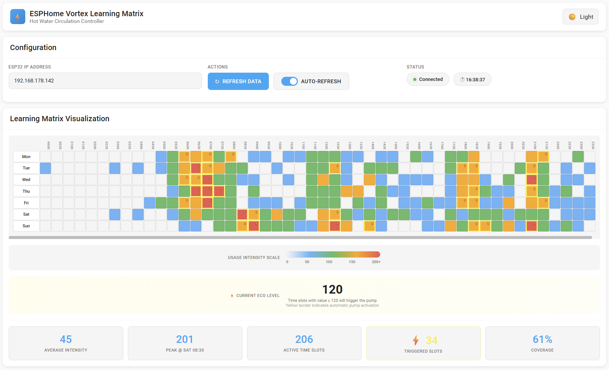

### Setup

1. Open the HTML file in a browser.
2. Enter the IP address of your HotCirc device in the configuration field.
3. Click **Refresh Data** to load the current learning matrix.

The IP is saved in your browser's local storage so you only need to enter it once.

### What it shows

The heatmap displays a 7-day by 48-slot grid. Each cell represents a 30-minute time window and is color-coded by learned usage intensity:

| Color | Value range | Meaning |
|---|---|---|
| Dark gray | 0 | No learned activity |
| Blue | 1 - 49 | Low activity |
| Green | 50 - 99 | Moderate activity |
| Orange | 100 - 149 | High activity |
| Red | 150 - 255 | Peak activity |

Cells where the value meets or exceeds the current ECO level are highlighted with a yellow border and a lightning bolt icon, indicating the pump would be triggered during that time slot.

Hover over any cell to see the exact value, day, and time.

### Statistics

Below the heatmap, summary statistics are shown:

- **Average Intensity** - mean value across all 336 slots
- **Peak** - highest value and when it occurs
- **Active Time Slots** - number of slots with any learned activity
- **Triggered Slots** - number of slots that meet the ECO level threshold
- **Coverage** - percentage of slots with activity

### Features

- **Auto-refresh** - toggle automatic data refresh every 60 seconds
- **Dark/Light theme** - switch between themes; preference is saved in local storage
- **ECO level display** - the current ECO level is read from the device and shown alongside the heatmap

### How it works

The page fetches the `Learning Matrix JSON` text sensor from the device's ESPHome web server at `/text_sensor/Learning%20Matrix%20JSON` (entity name, URL-encoded). The sensor updates every 5 minutes and immediately when the ECO level changes. It contains the ECO level and the full 7x48 matrix:

```json
{
  "eco_level": 120,
  "days": [
    {"name": "Mon", "values": [0, 0, ..., 80, 120, ...]},
    ...
  ]
}
```

The heatmap renders entirely client-side with no external dependencies.

---

## Home Assistant Integration

All variants connect to Home Assistant through the native ESPHome API; sensors, switches, buttons and sliders appear automatically.

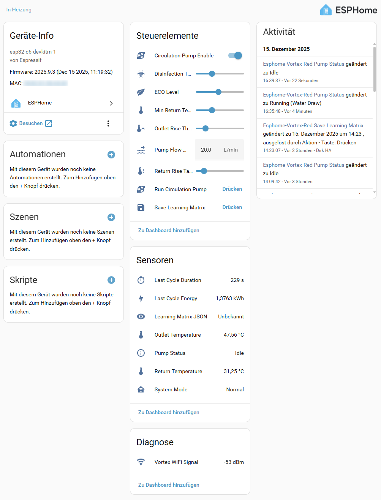

The `homeassistant/` folder additionally provides a **learning matrix heatmap card** for Lovelace dashboards:

| File | Purpose |
|---|---|
| `hotcirc-heatmap-card.js` | Custom card `custom:hotcirc-heatmap-card` (follows the HA theme, German/English) |
| `hotcirc.yaml` | Example package with the REST sensor that fetches the matrix JSON |
| `hotcirc_HA_readme_en.md` | Step-by-step setup guide (English) |
| `hotcirc_HA_readme.md` | Step-by-step setup guide (German) |

Because a Home Assistant state is limited to 255 characters, the matrix JSON is fetched by a REST sensor and stored in an attribute. Minimal card configuration:

```yaml
type: custom:hotcirc-heatmap-card
entity: sensor.hotcirc_lernmatrix
attribute: value
```

See [`homeassistant/hotcirc_HA_readme_en.md`](homeassistant/hotcirc_HA_readme_en.md) for the full setup and all card options.

---

## Configuration

### Component Parameters

These are set in the `esphome_hotcirc:` section of each YAML file. *Schema default* applies if the parameter is omitted; *shipped* is the value used in the provided YAML files.

| Parameter | Schema default | Shipped | Range | Description |
|---|---|---|---|---|
| `outlet_rise` | 1.5 | 1.0 | 0.1 - 5.0 | Outlet temperature rise to confirm a water draw (°C) |
| `return_rise` | 1.5 | 5.0 | 0.1 - 10.0 | Return temperature rise that stops the pump (°C) |
| `disinfection_temp_rise` | 10.0 | 10.0 | 5 - 20 | Outlet elevation above baseline that triggers disinfection (°C) |
| `min_return_temp` | 30.0 | 30.0 | 20 - 45 | Skip pump start if return temperature is already above this (°C) |
| `pump_flow_rate` | 3.0 | 20.0 | 0.5 - 50 | Pump flow rate for the energy calculation (L/min) |
| `anti_stagnation_runtime` | 15 | 15 | - | Duration of the weekly anti-stagnation run (s) |
| `thermal_stagnation_delta` | 2.0 | 2.0 | -5 - 10 | Flush if `outlet - return` falls below this (°C) |
| `thermal_stagnation_min_return` | 40.0 | 40.0 | 20 - 60 | Return temperature required for a flush (°C) |
| `thermal_stagnation_runtime` | 10 | 10 (Red: 30) | - | Duration of a thermal stagnation flush (s) |
| `thermal_stagnation_cooldown` | 1800 | 1800 | - | Minimum time between flushes (s) |
| `anti_stagnation_interval` | 172800 | - | - | **Deprecated**, ignored |

The first five values can also be changed at runtime through the web UI sliders (see below). The slider values are written directly into the component and take precedence; keep the slider `initial_value` and the component value consistent.

Required references:

| Parameter | Type | Description |
|---|---|---|
| `outlet_sensor` | sensor | DS18B20 outlet temperature sensor |
| `return_sensor` | sensor | DS18B20 return temperature sensor |
| `pump_switch` | switch | Pump relay or smart plug switch |
| `time_source` | time | SNTP or other RealTimeClock |

Optional references:

| Parameter | Type | Description |
|---|---|---|
| `button` | binary_sensor | Hardware button, evaluated by the component (see [Button Actions](#button-actions)) |
| `led_green` | output | Pump running indicator LED |
| `led_yellow` | output | Learning/status indicator LED |

Internal constants (`esphome_hotcirc.h` / `.cpp`):

| Constant | Value | Description |
|---|---|---|
| `MIN_RUN_TIME` | 30 s | Minimum pump run before the stop condition is checked |
| `MAX_RUN_TIME` | 480 s | Maximum pump run (safety cutoff, also disinfection run time) |
| `MINIMUM_DRAW_DURATION` | 15 s | Sustained rise required to confirm a water draw |
| `USER_REQUEST_MAX_AGE` | 1800 s | A water draw does not start the pump if it ran within this time |
| `DISINFECTION_COOLDOWN` | 3600 s | Minimum time between disinfection triggers |
| `LEARN_INC` | 40 | Matrix increment per confirmed water draw |
| `DECAY` | 0.98 | Daily learning matrix decay factor |
| Vacation threshold | 86400 s | No-draw duration before entering vacation mode |
| Anti-stagnation lockout | 1800 s | Lockout of draw detection and schedule after anti-stagnation |
| Thermal stagnation persistence | 10 s | Condition must hold this long before a flush |

### Web UI Controls

All variants expose the following through the ESPHome web server (port 80, version 3) and the Home Assistant API.

**Sensors:**

| Name | Unit | Description |
|---|---|---|
| Outlet Temperature | °C | Hot water outlet, 2 decimal places |
| Return Temperature | °C | Return/circulation water, 2 decimal places |
| HotCirc WiFi Signal | dBm | WiFi signal strength |
| Last Cycle Energy | kWh | Energy transferred in the last pump cycle |
| Last Cycle Duration | s | Duration of the last pump cycle |
| Pump Status | text | `Running: <trigger>`, `Disabled` or `Standby` |
| System Mode | text | `Normal` or `Vacation Mode` |
| Learning Matrix JSON | JSON | Full 7x48 matrix with ECO level |
| Smart Plug Connected | binary | Plug reachability (M5StickC/UEDX only) |

Trigger names in `Pump Status`: `Manual Button`, `Web UI`, `Water Draw`, `Scheduled`, `Disinfection`, `Anti-Stagnation`, `Thermal-Stagnation Flush`.

**Switches and lights:**

| Name | Description |
|---|---|
| Circulation Pump Enable | Master on/off for automatic and manual pump operation (default on, restored on boot) |
| Display Dark Mode | Enables the dark stage of the display dimming (UEDX only) |
| Display Backlight | Display backlight (M5StickC only) |

**Buttons:**

| Name | Description |
|---|---|
| Run Circulation Pump | Trigger a manual pump cycle |
| Save Learning Matrix | Persist learning data to flash |
| Test Smart Plug Connection | Check plug reachability and relay state (M5StickC/UEDX only) |
| Factory Reset | Erase all stored settings and reboot |
| Safe Mode Boot | Reboot into ESPHome safe mode |

**Number controls:**

| Name | Range | Step | Initial | Description |
|---|---|---|---|---|
| Outlet Rise Threshold | 0.5 - 3.0 | 0.1 | 1.0 | Water draw detection sensitivity (°C) |
| Return Rise Target | 3.0 - 15.0 | 0.5 | 5.0 | When to stop the pump (°C) |
| Minimum Return Temp | 20 - 40 | 1.0 | 30 | Skip-pump threshold (°C) |
| Disinfection Temp Rise | 8 - 20 | 1.0 | 10 | Disinfection detection threshold (°C) |
| Pump Flow Rate | 10 - 40 | 1.0 | 20 | For the energy calculation (L/min) |
| ECO Level | 0 - 255 | 5 | 120 | Learning schedule threshold |
| Display Brightness | 10 - 255 | 5 | 64 | Display brightness in the active stage (UEDX only) |

All slider values are restored after a reboot (except Display Brightness on the UEDX variant). Flash writes are batched and written every 5 minutes, so a change made just before a power loss may be lost. The *Initial* value only applies on the very first boot.

**Text inputs:**

| Name | Description |
|---|---|
| Smart Plug IP Address | IP of the ESPHome smart plug (M5StickC/UEDX only, saved to flash) |

### Button Actions

When a hardware button is passed to the component (`button:`), the component evaluates the press duration on release:

| Duration | Action |
|---|---|
| Short press (< 3 s) | Start the pump, or stop it if it is running |
| Long press (3 - 10 s) | Toggle learning enabled/disabled (yellow LED steady on = learning disabled) |
| Very long press (> 10 s) | Reset the learning matrix to the default pattern (yellow LED blinks three times) |

This applies to all three variants. The LED feedback is only available on the Red variant; on the UEDX variant, pressing the button additionally wakes the display.

> When using the `button:` option, do not trigger pump actions from the button's own YAML (`on_press`, `on_click`), otherwise one press starts the pump and the component stops it again on release.

### Logging

| Tag | Content |
|---|---|
| `hotcirc` | All controller events (draws, pump start/stop, modes) |
| `learning` | Full matrix dump every 60 s - set to `DEBUG` to see it |
| `smart_plug` | Plug commands, reachability and state reconciliation |
| `dim` | Display dimming stages (UEDX) |
| `correlation` | NTC vs. DS18B20 comparison (Red) |

---

## Installation

### Prerequisites

- A recent [ESPHome](https://esphome.io/) release (the configurations use `one_wire` + `dallas_temp`, `web_server` version 3, and on the UEDX variant `mipi_spi` and LVGL)
- One of the three supported boards
- Two DS18B20 temperature sensors
- A Vortex BWO155 circulation pump with the special PCB (Red variant) or an ESPHome-based smart plug (M5StickC/UEDX variants)

### Steps

1. Clone or download this repository.

2. Create a `secrets.yaml` next to the variant YAML files:
   ```yaml
   wifi_ssid: "YourNetwork"
   wifi_password: "YourPassword"
   local_path: /path/to/esphome-hotcirc/components   # used by Red and M5StickC
   ```
   The UEDX variant references the component with the relative path `components` and does not need `local_path`. `secrets.yaml` is excluded from Git by `.gitignore`.

3. Configure the DS18B20 sensors:
   - **Red / M5StickC:** both sensors share one bus. Replace the `address:` values with those of your sensors. The addresses of all devices found on the bus are listed in the ESPHome log at boot.
   - **UEDX:** each sensor has its own bus (GPIO39 outlet, GPIO40 return), no address needs to be configured.

4. For the M5StickC/UEDX variants, prepare the smart plug:
   - Flash the plug with ESPHome and enable `web_server`
   - Give its relay switch the ID `relay` (see [Smart Plug Control](#smart-plug-control))
   - Assign it a fixed IP address
   - Enter the IP in the HotCirc web UI after the first boot

5. Compile and flash:
   ```bash
   esphome run esphome-hotcirc_red.yaml             # Red variant
   esphome run esphome-hotcirc_m5stickc-plus2.yaml  # M5StickC variant
   esphome run esphome-hotcirc_uedx4646.yaml        # UEDX variant
   ```

6. On first boot the device creates a WiFi access point named "ESPhome-HotCirc". Connect to it to configure WiFi credentials via the captive portal, or uncomment the `ssid`/`password` lines in the YAML file.

7. Optional: set up the Home Assistant heatmap card, see [Home Assistant Integration](#home-assistant-integration).

---

## Upgrading

- **Learning matrix format:** The flash format now has a magic word and version field (48-slot layout, version 2). After updating from an older firmware, the saved matrix is discarded **once** and replaced by the default pattern. It is relearned over the following days.
- **`anti_stagnation_interval`:** deprecated and ignored; anti-stagnation now runs every Sunday at 03:00. You can remove the parameter from your YAML.
- **Water draw detection:** no YAML wiring is needed. The component hooks into the outlet sensor itself; the sensor only has to keep publishing every second.
- **Log tag:** all controller logs use the tag `hotcirc`. Logger entries for the old tag `hotwater` can be removed.

---

## Project Structure

```
esphome-hotcirc/
  components/
    esphome_hotcirc/
      __init__.py                          # ESPHome config schema and code generation
      esphome_hotcirc.h                    # HotWaterController class definition
      esphome_hotcirc.cpp                  # Core logic implementation
  docs/
    hotcirc_simulator.html                 # Interactive browser display simulator (GitHub Pages)
  homeassistant/
    hotcirc-heatmap-card.js                # Lovelace heatmap card
    hotcirc.yaml                           # Example HA package (REST sensor)
    hotcirc_HA_readme.md                   # HA setup guide (German)
    hotcirc_HA_readme_en.md                # HA setup guide (English)
  mechanics/
    base.STL                               # 3D-printable housing parts
    ring_cover.STL
  packages/
    esphome-hotcirc_gui.yaml               # LVGL GUI (UEDX4646 round display)
    esphome-hotcirc_dimming.yaml           # 3-stage display dimming / burn-in protection
    pump_icon.png                          # Pump icon (static)
    pump_icon_f0.png ... pump_icon_f2.png  # Pump icon animation frames
    pump_icon.xcf                          # GIMP source for the pump icon
    bg_idle_blue.png                       # State background: blue glow (idle)
    bg_running_orange.png                  # State background: orange glow (running)
    bg_disinfection_magenta.png            # State background: magenta glow (disinfection)
    link.txt                               # Reference link(s)
    bak/                                   # Backups of the GUI package and icons
  pcb/                                     # PCB design files
  pictures/
    heatmap.png                            # Heatmap screenshot
    Homeassistant.png                      # Home Assistant screenshot
    hotcirc_m5stickc-plus/                 # M5StickC Plus2 photos
    hotcirc_red/                           # Red / ESP32-C6 photos + schematic PDF
    hotcirc_uedx4646/                      # UEDX4646 photos and schematic
      States/                              # Rendered display states (standby, running, ...)
  esphome-hotcirc_m5stickc-plus2.yaml      # M5StickC Plus2 variant
  esphome-hotcirc_red.yaml                 # Red / ESP32-C6 variant
  esphome-hotcirc_red_ibom.html            # Interactive BOM for the Red PCB
  esphome-hotcirc_uedx4646.yaml            # UEDX4646 round display variant
  ESPHome_HotCirc_heatmap_ha_style.html    # Standalone learning matrix heatmap
  secrets.yaml                             # WiFi credentials and paths (not committed)
  COPYING, LICENSE                         # License texts
  .gitignore
```

### Core Component

The `esphome_hotcirc` component (`components/esphome_hotcirc/`) implements the `HotWaterController` class. It runs as a standard ESPHome `Component`:

- **Outlet sensor callback:** water draw detection, independent of `loop()` timing
- **`loop()`:** vacation mode, anti-stagnation, daily decay, disinfection detection, schedule check, thermal stagnation, pump control, button handling and LEDs

All internal timing is based on wrap-safe `millis()` differences, so the controller keeps working correctly beyond the 49-day `millis()` rollover.

### GUI Packages

The UEDX4646 variant pulls in reusable packages from `packages/`:

- `esphome-hotcirc_gui.yaml` - LVGL GUI: QSPI display, fonts, images, main page with ECO arc and state colors, heatmap page, touch zones and the "Display Brightness" slider. Layout positions are set centrally as substitutions at the top of the file.
- `esphome-hotcirc_dimming.yaml` - 3-stage dimming (active / dim / dark), wake-up handling and the "Display Dark Mode" switch

ESPHome merges the packages before validation, so they can reference IDs from the main YAML (e.g. `hotwater`, `outlet_temp`, `eco_level_config`) and vice versa.

---

## License

HotCirc uses two licenses: the **software is open source (GPLv3)**, the **hardware design is non-commercial (CC BY-NC-SA 4.0)**.

| Part | License |
|---|---|
| Software: ESPHome component, YAML configurations and packages, HTML tools, Home Assistant card | [GNU GPL v3.0 or later](https://www.gnu.org/licenses/gpl-3.0.html) |
| Hardware: schematics, PCB layout, Gerber files, BOM, mechanical parts | [CC BY-NC-SA 4.0](https://creativecommons.org/licenses/by-nc-sa/4.0/) |
| Pictures and documentation | [CC BY-NC-SA 4.0](https://creativecommons.org/licenses/by-nc-sa/4.0/) |

### Hardware: what is allowed

**You may:**

- Build HotCirc hardware for yourself or your own household
- Modify the design and share your modifications non-commercially, with attribution and under the same license

**You may not, without a written license from the author:**

- Manufacture, sell, or offer HotCirc PCBs, kits, or assembled devices
- Offer HotCirc hardware as part of a paid product or service, including installation services
- Remove or hide the attribution on the PCB or in the design files

Commercial hardware licenses are available on request via GitHub ([STB3](https://github.com/STB3)). Original HotCirc hardware is available directly from the author.

### Software

The firmware may be used, modified, and redistributed under the terms of the GPLv3, including on hardware of your own design.

See [LICENSE](LICENSE) for details.

Copyright (c) 2026 Dirk (STB3)
